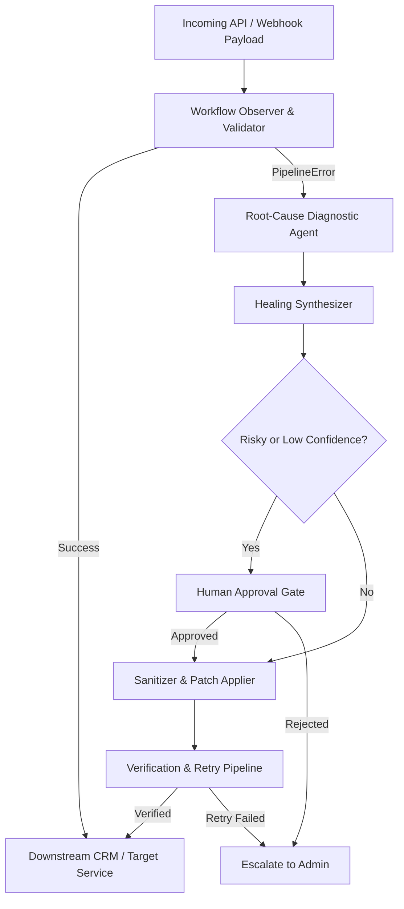

# The Self-Healing AI Automation System

> **Problem Statement 04 — AI Engineering / Intelligent Monitoring**  
> Autonomous error detection, root-cause diagnosis, and automated patch execution for mission-critical workflows.

---

## Overview

Modern software workflows and API integrations often fail due to unexpected payload formatting, upstream schema drift, missing fields, or downstream rate limiting (HTTP 429). Traditionally, resolving these failures requires manual, tedious intervention by engineers.

**The Self-Healing AI Automation System** acts as an autonomous resilience layer that:
1. **Monitors** pipeline execution and catches errors in real time.
2. **Diagnoses** the root cause using an LLM (Claude) with fallback deterministic heuristics.
3. **Synthesizes** minimal, safe, schema-compliant atomic patches.
4. **Verifies & Retries** the workflow, requesting human approval when patches carry risk or have lower confidence.
5. **Visualizes** system health and incident lifecycles on a real-time web dashboard.

---

## Architecture Blueprint



### Key Components

- **Workflow Observer & Validator**: Validates payloads against target schemas and executes downstream calls, catching mismatches and HTTP 429 throttling.
- **Root-Cause Diagnostic Agent**: Classifies failures (`schema_mismatch`, `bad_type`, `missing_field`, `rate_limit`) with explanation and confidence score using structured outputs from Anthropic Claude (or deterministic rule-based analysis if no key is present).
- **Healing Synthesizer**: Generates targeted JSON operations (`rename`, `cast`, `default`, `set_retry`) strictly checked against a whitelist sanitizer to ensure safe execution.
- **Human-in-the-Loop Gate**: If an action is risky (e.g. inventing missing field defaults) or confidence is below threshold, pauses the run until an operator approves or rejects via the dashboard.
- **Real-Time Recovery Visualizer**: A responsive dashboard with ECG pulse monitor, live incident log, diff visualizer (failed vs healed payload), and incident injection controls.

---

## Getting Started

### 1. Prerequisites
- Python 3.10+
- Anthropic API Key (optional — falls back to deterministic rule-based healing if not provided)

### 2. Installation
```bash
git clone https://github.com/lynxcodelx-ai/hailclaude.git
cd hailclaude
pip install -r requirements.txt
```

### 3. Run the System
```bash
# Optional: Enable LLM healing mode
export ANTHROPIC_API_KEY="your-api-key"

# Start the application
uvicorn main:app --reload --port 8000
```

Open your browser at `http://localhost:8000` to interact with the dashboard.

---

## Simulated Failure Scenarios

From the console UI, you can inject test incidents to observe the healing loop:
- **Send a healthy order**: Normal execution path without intervention.
- **Rename fields upstream (`schema_drift`)**: Simulates upstream API updates where fields change (e.g., `client.fullName` instead of `customer_name`).
- **Send amount as text (`bad_type`)**: Simulates currency formatting strings (e.g., `"₹1,234.50"`) requiring type casting.
- **Drop currency field (`missing_field`)**: Simulates missing required attributes, triggering the human approval workflow before applying defaults.
- **Throttle the CRM (`rate_limit`)**: Simulates HTTP 429 errors, synthesizing an exponential backoff and retry policy.
